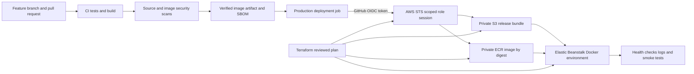

# EBKit DevOps implementation and deployment

Author: Rakesh Ku Patra
Task date: 17 October 2026 in Asia Kolkata
Repository: https://github.com/Rakesh-Patra/ebready
Branch: `feat/modern-workspace-deployment-improvements`

This guide explains how an application idea becomes a tested Docker image and a
repeatable AWS deployment. The practical project is EBKit, a React dashboard with
a Node API and Python deployment tools. The target for this exercise is the
dashboard itself on a **standard Elastic Beanstalk Docker environment**. That is
separate from the AWS Cluster Mode environments that EBKit can manage for users.

The aim is to demonstrate decisions, automation, security, validation and recovery.
Using more tools is not the goal. Ansible is unnecessary because Beanstalk manages
the host. A separate Prometheus or Grafana deployment is unnecessary for this demo;
CloudWatch dashboard, enhanced Beanstalk health, CPU and health alarms, and seven days of application/platform logs provide the requested baseline.

## What each tool does

- **Git and GitHub** preserve source history and isolate work on a feature branch.
- **CI** installs dependencies, runs tests, builds the UI and container, and checks infrastructure syntax.
- **DevSecOps checks** scan application dependencies, source secrets and the container before deployment credentials are requested.
- **Docker** packages the frontend, API and Python tools into one reproducible runtime. The final container runs as a nonroot user on port 8080.
- **Terraform** owns the environment, IAM roles, release bucket and image repository. A reviewed plan is applied before the first delivery.
- **OIDC** exchanges a GitHub identity token for a short lived AWS role session. There is no stored AWS access key in GitHub.
- **ECR** stores the already scanned image. Immutable tags prevent overwrites; the release uses the image digest.
- **S3** holds a small private versioned release ZIP containing `Dockerrun.aws.json`.
- **Elastic Beanstalk** provisions the managed Docker host, pulls the image, and reports deployment health.

## Architecture



## Prerequisites

1. A GitHub repository and permission to configure its Actions variables and deployment environments.
2. An AWS account and a local bootstrap identity permitted to create the named Beanstalk resources, IAM roles, S3 bucket and ECR repository.
3. Terraform 1.14.9, Node 22, Python 3.12 or later, Git and the AWS CLI.
4. An existing GitHub OIDC provider at `https://token.actions.githubusercontent.com` in AWS IAM. This account already has one; Terraform reads and reuses it.
5. A reviewed current Amazon Linux 2023 Docker platform in the target region.
6. A custom domain and ACM certificate for an authenticated public deployment. The default Beanstalk hostname is not automatically HTTPS.

The initial bootstrap uses the operator's AWS profile. Subsequent application
delivery uses OIDC from GitHub. Do not describe the bootstrap as an OIDC login.

## Step 1 Start with a clear application boundary

The app serves the React build, `/api` and the `/insforge` authentication proxy from
one origin. Server-only administration keys must never be included in the React
bundle. The public InsForge URL and anonymous key are public application settings;
they do not grant server administration rights.

For this practice environment, `EBKIT_PUBLIC_DEMO=true` disables the authentication
proxy and removes credential entry from the UI. `EBKIT_LIVE_ENABLED=false` and
`EBKIT_GITHUB_AUTO_DEPLOY=false` prevent this public dashboard from launching
customer AWS jobs. Visitors can still explore the guest simulation. This is a
demonstration deployment, not the full production multi-user control plane.

## Step 2 Use a feature branch

```powershell
git switch -c feat/modern-workspace-deployment-improvements
git fetch origin
git rebase origin/main
git diff --check
```

The branch was created, synced with the newer `main`, and pushed. A conflict in the
infrastructure tools UI was resolved while preserving exact confirmation and
Ready-state checks. A source scan found a deliberately fake AWS key in a redaction
test rather than a real credential. Do not commit `.env`, AWS profiles, job state,
Terraform plans or Terraform state.

## Step 3 Test and build locally

From the repository root:

```powershell
python -m pytest tests/test_aws_tls.py tests/test_managed_database.py tests/test_cluster_health_poll.py tests/test_controls.py tests/test_production_ops.py -q
cd web
$env:EBKIT_TEST_PYTHON=(Get-Command python.exe).Source
npm.cmd ci
npm.cmd test -- --pool=threads --maxWorkers=1 --testTimeout=15000
npm.cmd run build
cd ..
```

Earlier verified baseline: 52 relevant Python tests, 223 web tests and the production
build passed. New delivery and public-demo changes require their own fresh CI run;
use the current Actions run as the release evidence rather than reusing baseline counts.

Windows test troubleshooting: the default test process pool timed out on this
machine. A single threads worker completed. The ZIP tests also need a real Python
executable through `EBKIT_TEST_PYTHON`. These are runner configuration details,
not evidence that unexecuted tests passed.

## Step 4 Package the application with Docker

Read the root `Dockerfile` and `.dockerignore`.

The build stage runs `npm ci` and the Vite production build. The runtime stage
installs production Node dependencies and the Python CLI. It copies the built
frontend and server, runs as the `node` user, exposes port 8080, and includes a
health check against `/api/health`.

```bash
docker build -t ebkit:ci .
docker run --rm -p 8080:8080 -e EBKIT_PUBLIC_DEMO=true ebkit:ci
curl --fail http://127.0.0.1:8080/api/health
```

The local Docker daemon was unavailable during initial preparation. The GitHub
runner builds and scans the actual delivery image; do not claim a local image test
unless you have recorded it separately.

## Step 5 Define infrastructure in Terraform

Configuration lives under `infra/terraform`. The stack creates a single-instance
practice environment, CloudWatch dashboard and alarms, private encrypted release bucket, immutable ECR repository,
instance profile, Beanstalk health role and GitHub deployment role. The existing
GitHub OIDC identity provider is read rather than recreated.

```powershell
$env:AWS_PROFILE='default'
terraform '-chdir=infra/terraform' init
terraform '-chdir=infra/terraform' fmt -check
terraform '-chdir=infra/terraform' validate
terraform '-chdir=infra/terraform' plan '-var-file=deployment.tfvars.json' '-out=deployment.tfplan'
terraform '-chdir=infra/terraform' apply deployment.tfplan
```

The initial reviewed plan had 16 creations and no changes or deletions to existing
resources. Keep the lock file under version control. The local state and input
files are ignored. State was migrated to the private encrypted, versioned S3
release bucket under `terraform/dashboard.tfstate`, with native S3 state locking.
The GitHub application delivery role can access `releases/*`, not the state prefix. Do not pass secret values into Terraform variables.

A real troubleshooting event occurred during bootstrap: the newest AWS provider
used an S3 Control endpoint that failed DNS resolution. Some resources had already
been created. The recovery was to inspect saved state, pin AWS provider 6.26.0,
verify and retain the newly created empty bucket, review a plan with no deletions,
and resume. The resumed apply created the remaining seven resources successfully. Never blindly recreate resources after a
partial apply.

## Step 6 Set up GitHub OIDC securely

The trust policy requires both:

```text
aud = sts.amazonaws.com
sub = repo:Rakesh-Patra@147680316/ebready@1407395996:environment:production
```

GitHub's OIDC customization API reported immutable subjects for this repository.
The exact `sub_claim_prefix` includes owner and repository IDs. An initial trust
policy using only repository names was rejected; it was corrected to the exact
immutable prefix rather than weakening the policy with a wildcard. Other
repositories must query their own prefix instead of copying these IDs.

The production GitHub environment restricts deployment branches to the feature
branch used for today's demonstration and `main`. The workflow additionally
requires `github.ref_name == vars.DEPLOYMENT_BRANCH`. Fork pull requests run CI
without a cloud identity and cannot execute the deployment job.

Only the deploy job receives `id-token: write`. It exchanges the token using
`aws-actions/configure-aws-credentials`. Its role can push to this ECR repository,
write the release prefix in this S3 bucket, create versions for this application,
and update this one environment. Beanstalk also requires configuration permissions
on its exact account-and-region platform bucket even after bootstrap; these are
scoped to that bucket. Runtime object operations are limited to this environment's
`_runtime/*` prefix. Stack reads and updates are limited to its backing
`awseb-ENVIRONMENT_ID-stack` CloudFormation stack. Unrelated buckets, environment
runtime objects and stacks are outside these grants.
Read-only EC2, Auto Scaling and load balancer inventory APIs use `Resource: *`,
as required by the platform's deployment checks. Mutating stack and runtime
permissions remain environment-scoped. The role cannot create IAM roles, read
the Gemini secret or Terraform state, or provision the complete Terraform stack.

Repository Actions variables contain only configuration:

```text
AWS_REGION
AWS_ROLE_ARN
EB_ARTIFACT_BUCKET
ECR_REPOSITORY
EB_APPLICATION
EB_ENVIRONMENT
DEPLOYMENT_BRANCH
```

`scripts/github_delivery.py configure` sets these variables and the branch policy
using an existing Git Credential Manager credential in memory. It also reads the exact OIDC subject prefix into the ignored local Terraform input; apply that trust update before running delivery. It never writes or
prints that credential. Do not paste a GitHub token into the script or this guide.

## Step 7 Keep secrets in the right place

- AWS delivery credentials: generated temporarily through OIDC, not GitHub secrets.
- Public app settings: normal environment variables; no secrets are required for guest demo mode.
- Server secrets: the existing Gemini and InsForge administration keys are stored in AWS Secrets Manager; only their ARNs are passed through `secret_arns`. No secret values are committed or placed in Terraform state.
- Instance permission: `secretsmanager:GetSecretValue` is limited to those exact ARNs. Customer-managed KMS keys also require a reviewed `kms:Decrypt` grant.
- Future database passwords and connection URLs: use Secrets Manager references, scoped to the backend or workload that needs them.
- Future webhook signing secrets or private integration tokens: store them in Secrets Manager and verify signatures; do not expose them through the UI.
- TLS private keys: use ACM-managed certificates rather than committing certificate/key files.
- GitHub authentication for operator setup: stays in Git Credential Manager on the operator machine, not in the image or the repository.
- React settings: anything named `VITE_*` is browser-visible. Never place passwords, admin keys or cloud credentials there.
- Artifacts: the release ZIP contains only `Dockerrun.aws.json`. The scanned Docker image contains application source and runtime dependencies, not local environment files.

Beanstalk's `aws:elasticbeanstalk:application:environmentsecrets` namespace resolves
the secret during instance bootstrap on supported platform versions. Changing a
secret does not automatically prove that a running app has refreshed it; perform
and verify the appropriate environment refresh/redeployment.

## Step 8 Run CI and security gates

The pinned workflow is `.github/workflows/delivery.yml`.

The verification job runs relevant Python tests, all web tests, frontend build,
production dependency audit, Terraform format/validation, Docker build, Trivy
source and image scans, and CycloneDX SBOM generation. Scanner gates cover High
and Critical findings with available fixes; ignored unfixed findings are not a
claim of zero vulnerabilities. Reports are saved for review.

The scanned image is saved as a short-retention Actions artifact. Deployment
loads that exact image rather than rebuilding it. Action dependencies use commit
hashes, and Dependabot proposes updates. Scan findings should be fixed or reviewed
explicitly; do not disable the gate to obtain a green screenshot.

## Step 9 Deploy with short lived credentials

After CI succeeds, the production job obtains an AWS role session, logs in to ECR,
pushes a unique immutable image tag and reads its digest. The release script
validates that digest and writes a versioned Dockerrun bundle. It uploads that
bundle over TLS to private S3 and creates an Elastic Beanstalk application version.

`scripts/release_dashboard.py` creates a Standard application version without
optional pre-processing (this bundle contains only Dockerrun), updates the named
environment and waits for Ready/Green on the requested version. It records the
previous version before making the update. Terraform intentionally ignores
`version_label` drift so infrastructure ownership and application delivery do
not fight each other.

## Step 10 Verify the actual release

Acceptance evidence must show all of the following:

1. The Actions verification job succeeded and the deployment job actually ran.
2. OIDC role assumption succeeded without stored AWS access keys.
3. The image digest in the receipt matches the ECR image used by Dockerrun.
4. Beanstalk reports Ready and Green on the expected version.
5. The homepage, built JavaScript asset and `/api/health` return HTTP 200.
6. Health reports that hosted live cloud controls are disabled.
7. Public demo authentication requests are rejected; no passwords are submitted over HTTP.

The release receipt records the commit, run URL, image digest, application version,
previous version, endpoint, health and smoke results. A successful Terraform apply
alone is not proof that the EBKit application was deployed: the initial Beanstalk
sample application may be running before the first release job.

## CloudWatch observability

The `infra/terraform/observability.tf` stack defines a CloudWatch dashboard with
Beanstalk enhanced health, EC2 CPU, and network traffic. Two alarms monitor
unhealthy environment states and sustained CPU above 80 percent. An error query
helps find failures in application/platform logs. Beanstalk streams instance logs
and retains them for seven days.

The alarms are visible in CloudWatch but have no email or paging subscription
configured yet. Missing metrics are treated as missing, not as proof of healthy
operation. Memory usage and distributed traces require additional instrumentation;
they are not included in this baseline. No separate monitoring server is needed.

## Step 11 Demonstrate recovery

For a failed release, inspect Beanstalk Events, enhanced health and CloudWatch logs.
Use the receipt's previous application version after review:

```bash
aws elasticbeanstalk update-environment --region us-east-2 \
  --environment-name ebkit-dashboard-practice --version-label PREVIOUS_VERSION
```

Then repeat the same health and asset smoke checks. Do not claim a rollback test
until it was executed and verified. Application rollback does not roll back an
external database or destructive schema migration.

## Screenshots and evidence to submit

Capture actual tool or browser state, with the run time visible where possible:

1. GitHub branch and commit history showing today's source changes.
2. A successful Actions run with separate verification and deployment jobs.
3. The deploy step showing successful OIDC role assumption, with sensitive identifiers masked where useful.
4. Terraform's reviewed plan and successful apply summary.
5. ECR repository showing the immutable image digest.
6. Beanstalk overview showing the requested version and Ready/Green state.
7. The actual application in a browser and its public-demo notice.
8. The health endpoint and stored smoke-test receipt.
9. A security report and SBOM artifact.

Do not use generated mockups as deployment screenshots. A prior UI design image
can be included only when captioned as a design preview. If browser capture is
unavailable, provide raw receipts and state which screenshots still need capture.
Never screenshot passwords, access tokens, `.env` contents or secret values.

## Explain the project to judges

Start with the application problem and show the UI briefly. Then follow one source
commit through tests, security checks, the scanned image digest, OIDC login and the
running Beanstalk version. Explain why the delivery role cannot administer IAM.
Show the deployment receipt and a health check. Finish by explaining the previous
version rollback and the cleanup process. Present unfinished HTTPS or protection
work as a limitation rather than claiming production readiness.

The root Dockerfile now defaults to public demo mode. While HTTPS is missing,
the server rejects authentication and cloud/AI API calls; only health checks and
the browser-local simulation remain available. This prevents visitors from
spending the operator's AWS or Gemini budget through the public demonstration.

Suggested demonstration order: application idea, source branch, CI results,
security report, Terraform plan, OIDC trust, ECR digest, live release, health,
recovery and cost controls. This gives a coherent story rather than a list of tools.

## Cleanup and production differences

Keep the environment running only while needed for judging. Review Terraform's
destroy plan before terminating this named stack. The release bucket is versioned
and `force_destroy=false`; retained objects must be reviewed before deletion.
ECR images can also block repository deletion. Existing OIDC providers are shared
and are not owned or deleted by this stack.

Before production: configure domain and ACM-backed HTTPS, deliberately re-enable
authentication, review allowed origins, use a scoped server execution model for
customer AWS work, review the already encrypted remote Terraform backend, define service
objectives, and choose resilience appropriate to the application. A single
instance practice environment is not highly available.

## References

- [AWS Docker configuration](https://docs.aws.amazon.com/elasticbeanstalk/latest/dg/create_deploy_docker.container.console.html)
- [AWS enhanced health API configuration](https://docs.aws.amazon.com/elasticbeanstalk/latest/dg/health-enhanced-api.html)
- [AWS secret references in environment variables](https://docs.aws.amazon.com/elasticbeanstalk/latest/dg/AWSHowTo.secrets.env-vars.html)
- [AWS Standard application-version processing](https://docs.aws.amazon.com/elasticbeanstalk/latest/api/API_CreateApplicationVersion.html)
- [AWS Beanstalk platform bucket permissions](https://docs.aws.amazon.com/aws-managed-policy/latest/reference/AdministratorAccess-AWSElasticBeanstalk.html)
- [AWS S3 blocking SSE-C encryption](https://docs.aws.amazon.com/AmazonS3/latest/userguide/blocking-unblocking-s3-c-encryption-gpb.html)
- [GitHub OIDC with AWS](https://docs.github.com/en/actions/how-tos/secure-your-work/security-harden-deployments/oidc-in-aws)
- [GitHub deployment environments](https://docs.github.com/en/actions/concepts/workflows-and-actions/deployment-environments)
- [Terraform Elastic Beanstalk environment resource](https://registry.terraform.io/providers/hashicorp/aws/latest/docs/resources/elastic_beanstalk_environment)

## Execution evidence

Bootstrap completed with the standard Amazon Linux 2023 Docker environment.
The first pipeline correctly blocked delivery because the image included vulnerable
global npm tooling and Python setuptools 66.1.1. The Dockerfile was changed to
remove package managers from the final runtime and upgrade setuptools. A fresh
pipeline must confirm the remediation before the application release is accepted.

CloudWatch provisioning completed with four new monitoring resources and three
configuration updates. The Gemini and InsForge administration keys were stored
in AWS Secrets Manager; their values were not printed, committed or passed to
Terraform. The image remediation subsequently passed the security gate. OIDC role assumption
then succeeded after the immutable subject was configured. A policy simulation
confirmed that the delivery role cannot read the Gemini key or Terraform state,
cannot create unrelated buckets, and can publish its own application image. S3
metadata confirmed AES256 encryption and versioning for remote state. Beanstalk's standard
regional storage bucket was initialized with the operator profile after its first
application-version request exposed that bootstrap prerequisite.

Beanstalk version events exposed missing permissions on its regional platform
bucket. The delivery policy now permits the required configuration operations
on that exact bucket, runtime-object reads/writes beneath this environment's
`resources/environments/ENVIRONMENT_ID/_runtime/*` prefix, and source reads only
beneath the custom release prefix. It does not grant access to other environments.
Optional
application-version pre-processing is disabled for the Dockerrun-only Standard
bundle; AWS documents that this step validates env.yaml and .ebextensions rather
than Docker configuration. Six regression cases check the Standard API contract
and reject failed versions regardless of status capitalization. Build, security
scanning and post-deployment Ready/Green checks remain required.

The verified CI run for commit `a001a930c4a351897db512ae18bf988f3e4f3292`
passed 224 web tests and 58 targeted Python tests. The configured Trivy source and
image gates reported zero vulnerabilities and zero secret findings; this is scoped
to those scanners, severities and fixed-vulnerability settings, not a claim of
zero security risk. The SBOM is preserved alongside the reports. S3's existing
SSE-C encryption block is explicitly declared in Terraform to preserve the AWS
security default and avoid repeated drift.

The final results for today's deployment are appended here after verification.
Until that happens, infrastructure and workflow files are implementation evidence,
not proof of a successful public application release.
